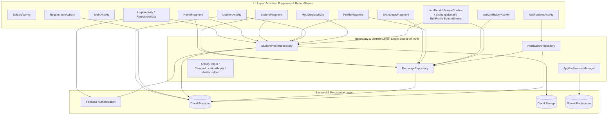
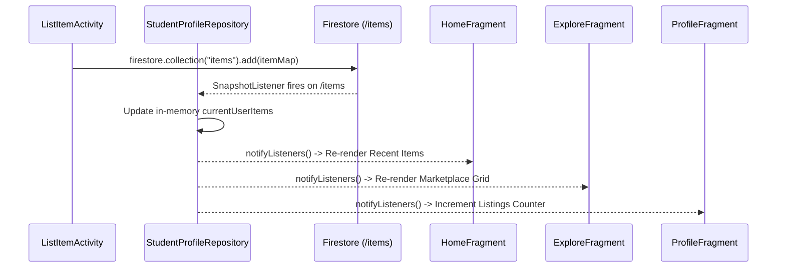

# BorrowBuddy – Backend & Architecture Dependency Map

**Document Version:** 1.0.0  
**Target:** Kotlin Clean Architecture, Repositories, Android ViewBinding, and Firebase SDK  

---

## 1. High-Level Architectural Layers

---

## 2. Component-to-Backend Dependency Matrix

| Screen / Component | Primary Repository | Secondary Repository | Firebase Service Directly Used | Backend Requirements |
| :--- | :--- | :--- | :--- | :--- |
| **`SplashActivity`** | None | None | `FirebaseAuth` | Check `currentUser != null` |
| **`LoginActivity`** | `StudentProfileRepository` | None | `FirebaseAuth` | `signInWithEmailAndPassword`, trigger profile sync |
| **`RegisterActivity`** | `StudentProfileRepository` | None | `FirebaseAuth`, `FirebaseFirestore` | `createUserWithEmailAndPassword`, write `users` & `public_profiles` |
| **`ForgotPasswordActivity`** | None | None | `FirebaseAuth` | `sendPasswordResetEmail` |
| **`MainActivity`** | `StudentProfileRepository` | `ExchangeRepository` | `FirebaseAuth` | Startup `syncWithFirebase`, bottom nav orchestration |
| **`HomeFragment`** | `StudentProfileRepository` | `ExchangeRepository` | `FirebaseFirestore` | SnapshotListener on `items` and `campus_requests` |
| **`ExploreFragment`** | `StudentProfileRepository` | `ExchangeRepository` | `FirebaseFirestore` | Query `items` with filter chips |
| **`ExchangesFragment`** | `ExchangeRepository` | `StudentProfileRepository` | None (currently) → `FirebaseFirestore` | Real-time `exchanges` query by `ownerUid`/`borrowerUid` |
| **`ProfileFragment`** | `StudentProfileRepository` | `ExchangeRepository` | `FirebaseAuth` | Display user stats, listings, compact activity, logout |
| **`ListItemActivity`** | `StudentProfileRepository` | None | `FirebaseFirestore` (partial) → `FirebaseStorage` | Upload photo to Storage, write document to `items` |
| **`RequestItemActivity`** | None | None | `FirebaseFirestore` | Write urgent request to `campus_requests` |
| **`StudentProfileActivity`** | `StudentProfileRepository` | `ExchangeRepository` | None (currently) → `FirebaseFirestore` | Read `public_profiles/{uid}` and `items` for student |
| **`MyListingsActivity`** | `StudentProfileRepository` | None | None (currently) → `FirebaseFirestore` | Read user's items from `StudentProfileRepository` |
| **`ActivityHistoryActivity`**| `ExchangeRepository` | None | None (currently) → `FirebaseFirestore` | Read user's transactions from `ExchangeRepository` |
| **`NotificationsActivity`** | `NotificationRepository` | `ExchangeRepository` | None (currently) → `FirebaseFirestore` | Real-time `notifications` query by `recipientUid` |
| **`ItemDetailBottomSheet`** | `StudentProfileRepository` | `ExchangeRepository` | None | Read item specs, check owner UID, check `isItemAvailable` |
| **`BorrowConfirmBottomSheet`**| `ExchangeRepository` | `StudentProfileRepository` | None (currently) → `FirebaseFirestore` | Write to `exchanges` via `ExchangeRepository.addBorrowRequest` |
| **`ExchangeDetailBottomSheet`**| `ExchangeRepository` | `StudentProfileRepository` | None (currently) → `FirebaseFirestore` | State transition mutations (`accept`, `confirmHandover`, etc.) |
| **`EditProfileBottomSheet`** | `StudentProfileRepository` | None | `FirebaseFirestore` → `FirebaseStorage` | Update `public_profiles/{uid}` and upload avatar |

---

## 3. Data Models and Serialization Mapping

| Model Class | Source File | Firestore Collection | Key Serialization Fields | Notes |
| :--- | :--- | :--- | :--- | :--- |
| **`StudentProfile`** | `model/StudentProfile.kt` | `public_profiles/{uid}` | `uid`, `fullName`, `college`, `department`, `yearSemester`, `bio`, `photoUri`, `isVerifiedCampusStudent`, `rating`, `completedLends`, `completedBorrows` | Private `email` stored strictly in `users/{uid}` |
| **`CampusItem`** | `model/CampusItem.kt` | `items/{itemId}` | `title`, `description`, `category`, `priceLabel`, `isFree`, `pickupSpot`, `ownerName`, `ownerUid`, `rating`, `imageUri`, `department`, `condition`, `maxDuration`, `securityDeposit`, `status`, `createdAt` | `drawableRes` used solely for offline mock fallback |
| **`GlanceRequest`** | `model/GlanceRequest.kt` | `campus_requests/{reqId}`| `name`, `location`, `item`, `avatarLetter`, `description`, `category`, `quantity`, `neededBy`, `expirationHours`, `state`, `uid`, `createdAt` | Replaces in-memory Glance carousel |
| **`ExchangeItem`** | `model/ExchangeItem.kt` | `exchanges/{exchangeId}` | `exchangeCode`, `itemId`, `title`, `category`, `imageUri`, `ownerUid`, `ownerName`, `ownerDept`, `borrowerUid`, `borrowerName`, `borrowerDept`, `pickupSpot`, `duration`, `priceLabel`, `isFree`, `securityDeposit`, `requestDate`, `handoverDate`, `expectedReturnDate`, `borrowerNote`, `status`, `currentStepIndex`, `pin`, `createdAt`, `updatedAt` | Core transactional record |
| **`NotificationItem`** | `model/NotificationItem.kt` | `notifications/{id}` | `recipientUid`, `senderUid`, `type`, `title`, `description`, `category`, `exchangeId`, `itemId`, `isRead`, `timestamp` | Real-time push / inbox notification record |

---

## 4. Cross-Screen Synchronization Topology

