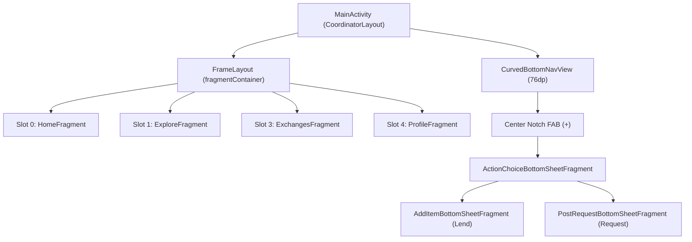
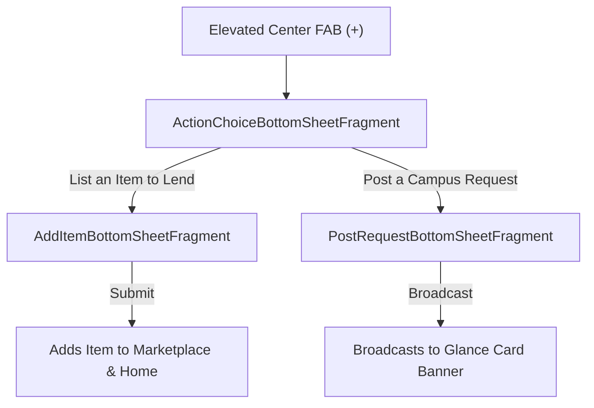
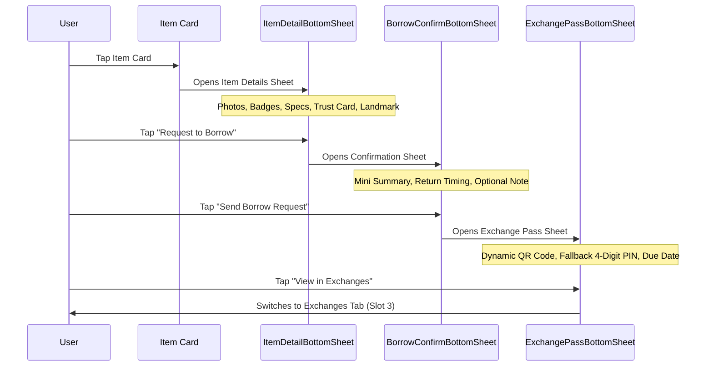
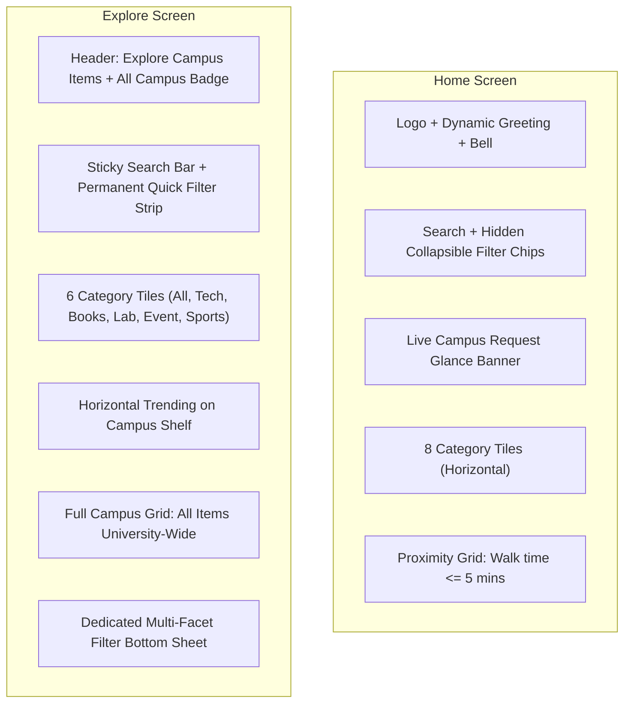

# BorrowBuddy — Android Application UI/UX Technical Blueprint

> **Specification Document & Architecture Blueprint**  
> **Application:** BorrowBuddy (`com.borrowbuddy.app`)  
> **Target OS:** Android (API 26+)  
> **Design Theme:** Airy Campus-Utility Marketplace (Blue & White Student Aesthetic)  
> **Document Purpose:** Complete, pixel-accurate UI/UX documentation of all existing screens, layout hierarchies, color tokens, typography, component behaviors, interaction patterns, and navigation routes.

---

## 1. Global Visual Identity & Design System Foundations

BorrowBuddy is engineered around a clean, student-utility aesthetic distinct from commercial e-commerce platforms. The palette is built on high-contrast navy, student-focused primary blue, energetic turquoise accents, and clean white card surfaces with 1px border strokes.

### 1.1 Color Tokens Palette

| Token Name | Hex Code | Android Resource | Primary Usage |
| :--- | :--- | :--- | :--- |
| **Canvas Background** | `#F8FAFC` | `@color/splash_bg`, `@color/brand_canvas` | Global screen viewport background, sheet secondary containers |
| **Surface White** | `#FFFFFF` | `@color/white` | Card backgrounds, search bar, active tab indicators, modals |
| **Brand Deep Navy** | `#0B2A6F` | `@color/brand_navy` | Primary headers, item card titles, paid badge background, primary labels |
| **Brand Primary Blue** | `#0F6CF2` | `@color/brand_blue`, `@color/btn_primary` | Active bottom nav icon/label, CTA buttons, selected chips, gradient start |
| **Brand Turquoise** | `#16C7BC` | `@color/brand_turquoise`, `@color/badge_free_bg` | "FREE" badge pills, "I Can Help" CTA, unread notification dots |
| **Light Blue Tint** | `#EEF4FF` / `#E0F2FE` | `@color/brand_blue_light` | Avatar circles, fallback image background, icon background containers |
| **Light Turquoise Tint**| `#E6FAF8` | `@color/brand_turquoise_light` | "Available Now" green pill background |
| **Slate Gray (Muted)** | `#64748B` | `@color/brand_slate` | Walk times, location pins, subtitles, inactive nav tabs, secondary body text |
| **Input Hint Gray** | `#94A3B8` | `@color/input_hint` | Placeholder text in search bars and edit fields |
| **Border Stroke Light**| `#E2E8F0` | `@color/border_light` | 1px card outlines, category tile borders, dividers |
| **Subtle Divider** | `#F1F5F9` | Bare Hex `#F1F5F9` | 1px divider in item card body and sheets |
| **Amber Warning** | `#F59E0B` / `#B45309` | `@color/star_gold` | "★" Star ratings and "POPULAR" trending badge text |
| **Emerald Green** | `#047857` / `#10B981` | Direct hex | "Available Now" pill dot, verified exchange text |

### 1.2 Typography Hierarchy

- **Font Family:** `Inter` / Roboto (`sans-serif`, `sans-serif-medium`, `sans-serif-bold`, `sans-serif-black`)
- **Display Titles (20sp):** `sans-serif-black`, `#0B2A6F`, line-height tight (e.g. Item Details title, Exchanges header, Add Item header).
- **Page Headings (19sp / 18sp):** `sans-serif-black`, `#0B2A6F` (e.g. "Explore Campus Items", "My Exchanges", "Filter & Sort").
- **Greeting / Header (17sp):** `sans-serif-bold`, `#0B2A6F` ("Hello, Harsh!").
- **Section Headers (15sp):** `sans-serif-black`, `#0B2A6F` ("Browse Categories", "Available near you", "Trending on Campus").
- **Card Titles (13.5sp – 14.5sp):** `sans-serif-bold`, `#0B2A6F`, 1–2 line clamp with ellipsis.
- **Form Labels & Spec Headers (13sp):** `sans-serif-bold`, `#0B2A6F`.
- **Metadata & Subtitles (11sp – 12sp):** `sans-serif-medium` or `sans-serif`, `#64748B`.
- **Badge & Chip Text (10.5sp – 11.5sp):** `sans-serif-bold` or `sans-serif-black`.
- **Tiny Microcopy (8.5sp – 9.5sp):** `sans-serif-black`, uppercase (e.g., "POPULAR", avatar initials).

### 1.3 Radii, Elevations & Spacing Rules

- **Corner Radii:**
  - Cards: `18dp` (`@layout/item_campus_card`), `16dp` (`@layout/fragment_bottom_sheet_action_choice`), `20dp` (`@drawable/bg_glance_card`).
  - Category Tiles: `12dp` (`@drawable/bg_category_tile`).
  - Bottom Sheets: `24dp` top corners (`@drawable/bg_bottom_sheet`).
  - Search Bars & Input Pills: `999dp` full pill (`@drawable/bg_search_bar`).
  - Action Buttons: `12dp` to `14dp` (`@color/btn_primary`).
  - Elevated Center FAB: `48dp x 48dp` circular (`bg_fab_gradient`).
- **Elevations & Shadows:**
  - Standard Cards: `app:cardElevation="1dp"` with `app:strokeWidth="1dp"` and `app:strokeColor="@color/border_light"`.
  - Glance Request Card: `app:cardElevation="2dp"`.
  - Curved Bottom Nav: Software layer shadow `10dp` radius, `Color.parseColor("#15000000")`.
  - Center Action FAB: `elevation = 8dp`.
  - Bottom Sticky CTAs: `android:elevation="8dp"`.
- **Screen Margins & Gutters:**
  - Outer screen horizontal padding: `16dp`.
  - Bottom content buffer (under-nav clearance): `96dp`.
  - Card grid spacing: `4dp` item margins in 2-column grid (`8dp` total column gutter).

---

## 2. Global Shell & Navigation Framework

The application runs inside a single-activity shell (`MainActivity.kt` & `activity_main.xml`) using a `CoordinatorLayout` host, an edge-to-edge window configuration with system bar insets, and a custom animated bottom navigation bar.

### 2.1 Curved Bottom Navigation (`CurvedBottomNavView.kt`)
- **Container Height:** `76dp`, anchored to `android:layout_gravity="bottom"`.
- **Notch Geometry:** Custom Canvas Bezier drawing:
  - Width: Full viewport width.
  - Background fill: `#FFFFFF` with soft upward drop shadow (`setShadowLayer(10dp, 0, -3dp, #15000000)`).
  - Center Notch: Radius `38dp`, depth `24dp`, top baseline `14dp`. Smooth cubic Bezier curves scoop downward and rise back up to create a physical pocket.
- **Center Action Button (`fabCenterAdd`):**
  - Dimensions: `48dp x 48dp` circular frame, elevated `8dp`, positioned at `Gravity.TOP | Gravity.CENTER_HORIZONTAL` with `topMargin = 2dp`.
  - Background: Gradient from `#16C7BC` (Turquoise) to `#0F6CF2` (Blue) angled at 135° (`bg_fab_gradient.xml`).
  - Icon: Centered white vector `ic_plus` (`24dp x 24dp`).
  - Animation: Scale pulse (`0.9x` for 100ms, springing back to `1.0x` for 120ms).
- **Navigation Slots:**
  - **Slot 0 (Home):** Icon `ic_nav_home.xml` (22dp) + Label `"Home"` (10.5sp).
  - **Slot 1 (Explore):** Icon `ic_nav_explore.xml` (22dp) + Label `"Explore"` (10.5sp).
  - **Slot 2 (Center Spacer):** Empty 22dp spacer creating clearance for the center FAB.
  - **Slot 3 (Exchanges):** Icon `ic_nav_exchanges.xml` (22dp) + Label `"Exchanges"` (10.5sp).
  - **Slot 4 (Profile):** Icon `ic_nav_profile.xml` (22dp) + Label `"Profile"` (10.5sp).
- **Active / Inactive State Transitions:**
  - Active: `#0F6CF2` icon tint, `#0F6CF2` label, `Typeface.DEFAULT_BOLD`.
  - Inactive: `#64748B` icon tint, `#64748B` label, `Typeface.DEFAULT`.
  - Fragment switching uses smooth fade animations (`android.R.anim.fade_in`, `android.R.anim.fade_out`).

---

## 3. Screen 1: Home Screen

- **Fragment Class:** `com.borrowbuddy.app.ui.HomeFragment`
- **Layout File:** `app/src/main/res/layout/fragment_home.xml`
- **Primary Purpose:** Instant peer discovery for items physically available within a ~5-minute walking distance of the student, plus live broadcast request updates.

### 3.1 Layout Hierarchy (Top to Bottom)

1. **Root Container:** `androidx.core.widget.NestedScrollView` (`id: scrollHome`)
   - Attributes: `background="@color/splash_bg"`, `fillViewport="true"`, `scrollbars="none"`.
   - Inner `LinearLayout` (vertical): `paddingStart="16dp"`, `paddingEnd="16dp"`, `paddingTop="12dp"`, `paddingBottom="96dp"`.

2. **Top App Bar Row (Single Row):**
   - **Left:** `MaterialCardView` (`40dp x 40dp`, corner radius `12dp`, white background, 1dp border `#E2E8F0`). Holds `ImageView` (`28dp x 28dp`) rendering the official BorrowBuddy logo mark (`@drawable/logo`).
   - **Center:** `TextView` (`id: tvGreeting`, weight `1`, `textSize="17sp"`, `sans-serif-bold`, `#0B2A6F`, max 1 line with ellipsis). Dynamically displays `"Hello, [FirstName]!"` (e.g. `"Hello, Harsh!"`).
   - **Right:** Notification Bell `FrameLayout` (`id: btnNotificationBell`, `38dp x 38dp`, background `@drawable/bg_back_button`). Contains `ImageView` (`20dp`, `@drawable/ic_notification`) and unread indicator dot (`id: viewNotifDot`, `8dp x 8dp`, `@drawable/bg_badge_free` turquoise, anchored `top|end`).

3. **Search & Quick Filter Section:**
   - Full-width pill container (`height="48dp"`, background `@drawable/bg_search_bar` white with 1dp border `#DCE5F2`, `paddingStart="14dp"`, `paddingEnd="8dp"`).
   - Left search icon: `ImageView` (`20dp`, `@drawable/ic_search`).
   - Input field: `EditText` (`id: etSearch`, weight `1`, null background, hint `"Search books, gadgets, notes..."`, text color `#0B2A6F`, hint color `#94A3B8`, `textSize="13sp"`).
   - Clear icon: `ImageView` (`id: btnClearSearch`, `28dp`, `@drawable/ic_close`, visibility toggled on text input).
   - Filter toggle button: `ImageView` (`id: btnFilterToggle`, `32dp x 32dp`, background `@drawable/bg_back_button`, `@drawable/ic_filter`, padding `7dp`).

4. **Collapsible Filter Chips Strip:**
   - `HorizontalScrollView` (`id: scrollFilterChips`, `visibility="gone"` by default, expands on filter icon tap).
   - Horizontal `LinearLayout` containing 5 pill chips:
     - `chipAll` ("All") — Active by default (`bg_chip_selected`, white text).
     - `chipFree` ("Free") — Inactive (`bg_chip_unselected`, `#0B2A6F` text).
     - `chipPaid` ("Paid (₹/day)") — Inactive.
     - `chipIMBA` ("IMBA") — Inactive.
     - `chipIMSC` ("IMSc.IT") — Inactive.

5. **Live Campus Request Glance Card (Carousel Banner):**
   - `MaterialCardView` (`id: cardGlance`, corner radius `20dp`, elevation `2dp`, transparent stroke).
   - Background: Gradient from `#0F6CF2` to `#0B2A6F` (`@drawable/bg_glance_card`), padding `12dp`.
   - Inner Row:
     - **Requester Avatar:** `TextView` (`id: tvGlanceAvatar`, `40dp x 40dp`, circular turquoise background `@drawable/bg_badge_free`, bold `#0B2A6F` letter).
     - **Request Text:** `TextView` (`id: tvGlanceText`, weight `1`, `textSize="12sp"`, `#EEF4FF`, 2-line spacing). Example: *"Riya at Main Library needs a Scientific Calculator"*.
     - **CTA Button:** `MaterialButton` (`id: btnGlanceHelp`, `36dp` height, background `@color/brand_turquoise`, text `"I Can Help"`, text color `#0B2A6F`, bold 11sp, corner radius `18dp`).
   - **Pagination Indicator:** 3 dots (`id: dot0, dot1, dot2`). Active dot expands to `14dp x 5dp` pill; inactive dots are `6dp x 5dp` with 40% alpha.
   - **Behavior:** Auto-rotates every 5 seconds. Touch/swipe pauses timer; release resumes.

6. **Browse Categories Section:**
   - Header Row: Section title `"Browse Categories"` (`15sp`, `sans-serif-black`, `#0B2A6F`) on left; `"See all"` button (`id: btnSeeAllCategories`, `12sp`, bold `#0F6CF2`) on right.
   - Horizontal Scroll: `HorizontalScrollView` (`id: scrollCategories`) containing 8 category tiles (`92dp` width $\times$ `96dp` height, background `@drawable/bg_category_tile`, corner radius `12dp`):
     1. `tileCatTech`: Icon `@drawable/ic_cat_tech`, label `"Tech & Chargers"`.
     2. `tileCatBooks`: Icon `@drawable/ic_cat_books`, label `"Books & Notes"`.
     3. `tileCatLab`: Icon `@drawable/ic_cat_lab`, label `"Lab & Aprons"`.
     4. `tileCatEvent`: Icon `@drawable/ic_cat_event`, label `"Event & AV Kits"`.
     5. `tileCatStationery`: Icon `@drawable/ic_cat_stationery`, label `"Stationery & Tools"`.
     6. `tileCatSports`: Icon `@drawable/ic_cat_sports`, label `"Sports & Fitness"`.
     7. `tileCatBusiness`: Icon `@drawable/ic_cat_business`, label `"Business & IMBA"`.
     8. `tileCatCampus`: Icon `@drawable/ic_cat_campus`, label `"Campus & Admin"`.
   - Interaction: Tap category highlights tile with `@drawable/bg_category_tile_selected` (`#0F6CF2` stroke and soft blue fill) and filters the grid. Tap again or tap "See all" resets.

7. **Available Near You Grid Section:**
   - Header Row: Title `"Available near you"` (`id: tvSectionTitle`, `15sp`, `sans-serif-black`, `#0B2A6F`) + Proximity Badge (`"≤ 5m walk"`, turquoise background) on left; `"View all"` button (`id: btnViewAll`, `12sp`, bold `#0F6CF2`) on right.
   - Grid: `RecyclerView` (`id: rvCampusItems`, `GridLayoutManager` with `spanCount="2"`, `isNestedScrollingEnabled="false"`).
   - Proximity Rule: Displays strictly items within 5-minute walking distance (`CampusLocationHelper.isNearby(..., maxMinutes = 5)`). If a search keyword is entered, distance constraint is lifted.
   - Tapping `"View all"` navigates directly to the Explore tab (`MainActivity.navigateToTab(1)`).

8. **Empty State (`layoutEmptyState`):**
   - White card (`@drawable/bg_card_white`), padding `24dp`, hidden by default.
   - Label: `"No matching items found"` (`14sp`, `#0B2A6F`).
   - Action: `"Show all items"` button (`id: btnResetSearch`, `12.5sp`, `#0F6CF2`).

---

## 4. Screen 2: Explore Screen

- **Fragment Class:** `com.borrowbuddy.app.ui.ExploreFragment`
- **Layout File:** `app/src/main/res/layout/fragment_explore.xml`
- **Primary Purpose:** Comprehensive, campus-wide discovery across all university departments, faculty buildings, and campuses without geographical distance limits.

### 4.1 Layout Hierarchy (Top to Bottom)

1. **Sticky Top App Bar & Search Container (Non-Scrolling):**
   - Direct child of root `LinearLayout`. Stays anchored at top during scrolling.
   - **Header Row:**
     - Left: Title `"Explore Campus Items"` (`19sp`, `sans-serif-black`, `#0B2A6F`).
     - Right: Scope pill badge `"All Campus"` (`background="@drawable/bg_badge_free"`, white text, `11sp`).
   - Subtitle: `"Discover peer-to-peer student listings across the university."` (`11.5sp`, `#64748B`).
   - **Search Input Bar:**
     - Dimensions: `48dp` height, background `@drawable/bg_search_bar`.
     - Icon: `ic_search` (20dp).
     - Field: `EditText` (`id: etExploreSearch`, hint `"Search books, gadgets, notes, tools..."`, `13sp`, `#0B2A6F`).
     - Clear button: `btnClearExploreSearch` (`ic_close`).
     - Filter button: `FrameLayout` (`id: btnExploreFilterToggle`, `34dp x 34dp`, `@drawable/bg_back_button`) with filter icon `ic_filter` and dynamic turquoise active dot (`id: viewFilterActiveDot`).
   - **Quick Sort & Filter Strip:**
     - Horizontally scrollable row of `32dp` height chips:
       1. `chipFilterSheetTrigger`: Contains `ic_sort` icon + dynamic text (`id: tvActiveSortLabel`, default `"Recently Added"`). Tapping opens `ExploreFilterBottomSheetFragment`.
       2. `chipQuickFree`: Toggle `"Free Only"`.
       3. `chipQuickPaid`: Toggle `"Paid (₹/day)"`.
       4. `chipQuickTopRated`: Toggle `"★ 5.0 Rated"`.
       5. `chipQuickNearest`: Toggle `"Nearest First"`.

2. **Scrollable Marketplace Body:**
   - Container: `androidx.core.widget.NestedScrollView` (`id: scrollExploreContent`, `paddingBottom="96dp"`).

3. **Explore Category Discovery Section:**
   - Header Row: `"Explore by Category"` (`15sp`, `sans-serif-black`, `#0B2A6F`) on left; `"View all"` (`id: btnResetCategoryFilter`, `12sp`, `#0F6CF2`) on right.
   - Category Carousel: Horizontal scroll with 6 tiles (`88dp` width $\times$ `94dp` height):
     - `tileExploreCatAll`: Label `"All Items"` (selected by default with blue stroke and icon).
     - `tileExploreCatTech`: Label `"Tech & Chargers"`.
     - `tileExploreCatBooks`: Label `"Books & Notes"`.
     - `tileExploreCatLab`: Label `"Lab & Aprons"`.
     - `tileExploreCatEvent`: Label `"Event & AV Kits"`.
     - `tileExploreCatSports`: Label `"Sports & Fitness"`.

4. **Trending on Campus Showcase:**
   - Container: `LinearLayout` (`id: layoutTrendingSection`). Automatically hides when active text search or specific category filter is applied.
   - Header: `"🔥 Trending on Campus"` (`15sp`, `sans-serif-black`, `#0B2A6F`) + `"High demand"` pill (`#64748B`).
   - Carousel: Horizontal `RecyclerView` (`id: rvTrendingItems`, layout `item_trending_card.xml`).
   - Card Architecture (`item_trending_card.xml`):
     - Width `164dp`, corner radius `18dp`, elevation `1.5dp`, stroke `1dp` `#E2E8F0`.
     - Image container (`108dp` height) with ShapeableImageView (`Corner.Medium`).
     - Top-Left Badge: `"🔥 POPULAR"` glassmorphic pill (`bg_trending_pill`, amber text `#B45309`).
     - Top-Right Badge: Price pill (**FREE** in `#16C7BC` or **₹[amount]/day** in `#0B2A6F`).
     - Card Body: Bold item title (`13sp`, 1-line clamp), Location row (`ic_location_pin` + `[CampusZone] • [WalkTime]`), divider line, and footer with owner initial avatar + rating (`★ 5.0`).
     - Click Action: Opens `ItemDetailBottomSheetFragment`.

5. **All Campus Listings Grid:**
   - Header Row: Title `"All Campus Listings"` (`id: tvAllListingsTitle`, dynamically changes to `"Search Results ("...")"` or `"[Category] Listings"`) + Count Badge (`id: tvItemsCountBadge`, e.g. `"10 Available"`).
   - 2-Column Grid: `RecyclerView` (`id: rvExploreItems`, layout `item_campus_card.xml`, `GridLayoutManager` 2-column).
   - Unrestricted Scope: Displays all items regardless of walk distance.

6. **Empty State (`layoutEmptyState`):**
   - Centered container with 64dp icon circular frame (`bg_category_icon_container` with `ic_search` in `#0F6CF2`).
   - Title: `"No campus items found"` (`16sp`, `sans-serif-black`, `#0B2A6F`).
   - Description: `"Try adjusting your keywords, switching categories, or clearing active filters."` (`12sp`, `#64748B`).
   - Action: `MaterialButton` (`id: btnResetSearchAndFilter`, `"Reset All Filters"`, `#0F6CF2`, corner radius `10dp`).

---

## 5. Screen 3: Add Listing & Campus Sharing Flows

Accessed by tapping the elevated center FAB (`+`) in the bottom navigation bar.

### 5.1 Action Choice Bottom Sheet (`ActionChoiceBottomSheetFragment`)
- **Layout File:** `fragment_bottom_sheet_action_choice.xml`
- **Top Elements:** 40dp drag handle pill, Title `"Campus Sharing"` (`18sp`, `sans-serif-black`), Subtitle `"Choose what you would like to do"`.
- **Card 1 (`cardOptionLend`):**
  - Icon: 44dp turquoise container with `ic_action_lend` (`24dp`).
  - Title: `"List an Item to Lend"` (`14sp`, bold `#0B2A6F`).
  - Subtitle: `"Lend textbooks, gadgets, calculators or lab gear to campus peers"`.
  - Action: Closes sheet and opens `AddItemBottomSheetFragment`.
- **Card 2 (`cardOptionRequest`):**
  - Icon: 44dp blue container with `ic_action_request` (`24dp`).
  - Title: `"Post a Campus Request"` (`14sp`, bold `#0B2A6F`).
  - Subtitle: `"Can't find what you need? Broadcast your need to students nearby"`.
  - Action: Closes sheet and opens `PostRequestBottomSheetFragment`.

### 5.2 Add Item to Lend Sheet (`AddItemBottomSheetFragment`)
- **Layout File:** `fragment_bottom_sheet_add_item.xml`
- **Container:** `NestedScrollView` with top drag pill, Title `"List an Item to Lend"` (`20sp`), and subtitle.
- **Form Fields:**
  1. **Image Picker Card (`cardImagePicker`):** `140dp` height, light blue background (`#EEF4FF`), dashed border `#DCE5F2`. Shows upload prompt with `ic_upload` icon and `"Tap to select photo from gallery"`. Replaced by `ivSelectedImage` upon photo selection via Android photo picker.
  2. **Item Title Input (`etTitle`):** Single-line edit text with hint `"e.g. Scientific Calculator, Type-C Charger"`.
  3. **Description & Condition (`etDescription`):** Multi-line text field (`72dp` height) with hint `"Describe the condition, specs, or usage instructions..."`.
  4. **Category Selection (`chipGroupCategory`):** Single-selection horizontal chips: *Tech & Chargers*, *Books & Notes*, *Lab & Study*, *Event Kits*.
  5. **Lending Rate Radio Group (`rgPricing`):**
     - Option A: `"Free to Borrow"` (`rbFree`, checked by default).
     - Option B: `"Paid Daily Rate"` (`rbPaid`). Selecting reveals `etDailyPrice` numeric input (`"Enter daily rate (e.g. 25)"`).
  6. **Campus Pickup Spot (`etPickupSpot`):** Input with hint `"e.g. Main Library, IMSc.IT Lab 2, Canteen"`.
  7. **Submit CTA Button (`btnSubmitItem`):** Full-width button (`52dp` height, `#0F6CF2`, corner radius `14dp`) labeled `"List Item to Lend"`.
- **Submission Behavior:** Creates a new `CampusItem`, saves to Firestore collection `"items"`, prepends to local home list, selects Home tab (slot 0), and scrolls to top.

### 5.3 Post Campus Request Sheet (`PostRequestBottomSheetFragment`)
- **Layout File:** `fragment_bottom_sheet_post_request.xml`
- **Purpose:** Allows students to broadcast an immediate physical need.
- **Form Fields:**
  1. `"What do you need?"` (`etRequestItem`): e.g. *"Scientific Calculator fx-991EX"*.
  2. `"Where are you currently located?"` (`etRequestLocation`): e.g. *"Main Library, IMSc.IT Lab"*.
  3. `"Target Department"` (`rgRequestDepartment`): Radio buttons for *All Campus*, *IMSc.IT*, and *IMBA*.
- **Action Button (`btnBroadcastRequest`):** Full-width `#0F6CF2` button (`50dp` height, corner radius `25dp` pill) labeled `"Broadcast Request"`.
- **Submission Behavior:** Injects a new `GlanceRequest` into the front of the Glance banner rotation on the Home screen and alerts nearby students.

---

## 6. Screen 4: Product Details & Handover Flow

Tapping any product card in Home, Explore, or Trending opens this multi-stage interaction flow.

### 6.1 Item Detail Modal Sheet (`ItemDetailBottomSheetFragment`)
- **Layout File:** `fragment_bottom_sheet_item_detail.xml`
- **Structure:**
  - **Header Bar:** Center 40dp drag pill + Right close button `btnCloseDetail` (`ic_close`).
  - **Section 1 — Media & Title Header:**
    - Large item photo (`190dp` height, ShapeableImageView `Corner.Large`).
    - Top-Left: `"Available Now"` status pill (`bg_green_pill` with green pulsing dot).
    - Top-Right: Price badge pill (**FREE** in `#16C7BC` or **₹[amount]/day** in `#0B2A6F`).
    - Full Item Title: `20sp`, `sans-serif-black`, `#0B2A6F`.
    - Category Tag: `12sp`, `#0F6CF2` (e.g. *"Lab & Study Tools • IMSc.IT Department"*).
  - **Section 2 — Lender's Description & 3 Info Pills:**
    - Light gray container (`#F8FAFC`, border `#E2E8F0`, corner radius `16dp`).
    - Usage notes & condition description text (`12.5sp`, `#64748B`).
    - 3 Equal Info Pills (`bg_spec_pill`):
      1. **Condition:** e.g. *"Like New"*, *"Crisp Pages"*, *"Pristine"*.
      2. **Max Duration:** e.g. *"Up to 3 days"*, *"Up to 5 days"*.
      3. **Security Deposit:** e.g. *"None"*, *"₹100 (Refundable)"*, *"College ID"*.
  - **Section 3 — Lender Trust Card:**
    - White card (`#FFFFFF`, border `#E2E8F0`, corner radius `16dp`).
    - Left: Lender circular avatar initial (`40dp x 40dp`, `#EEF4FF` fill, `#0F6CF2` bold letter).
    - Center: Lender full name (`14sp` bold), course/semester badge (e.g. *"IMSc.IT Sem 4"*), rating (`★ 5.0`), and completed lends counter (e.g. *"18 campus lends"* in emerald green).
    - Right: Secondary outline `"Message"` button (`btnMessageLender`, icon `ic_message_outline`).
  - **Section 4 — Pickup Landmark & Settlement Notice:**
    - Landmark row: Location pin icon + `[CampusZone] • [WalkTime]` (e.g. *"Main Library Entrance • 2 min walk"*).
    - Settlement Note: Explains direct peer settlement at pickup (e.g. *"Free Peer Lending (₹0) — Settle directly with lender at pickup. No payment gateway or commission."*).
  - **Section 5 — Sticky Bottom Action Bar:**
    - White background container with `elevation="8dp"`.
    - Primary CTA: `MaterialButton` (`id: btnRequestBorrow`, `52dp` height, `#0F6CF2`, corner radius `14dp`) labeled `"Request to Borrow"`.

### 6.2 Borrow Confirmation Sheet (`BorrowConfirmBottomSheetFragment`)
- **Layout File:** `fragment_bottom_sheet_borrow_confirm.xml`
- **Mini Item Summary:** Card showing 54dp square item thumbnail, item title, lender name, pickup spot, and price badge.
- **Return Schedule Selector:**
  - Label: `"Select Return Date & Time"` (`13sp`, bold).
  - 3 Quick Chips:
    - `chipReturnToday5pm` ("Today, 5:00 PM") — Selected by default (`#0F6CF2`).
    - `chipReturnTomorrow` ("Tomorrow, 12:00 PM") — Unselected.
    - `chipReturn3Days` ("In 3 Days") — Unselected.
- **Optional Note Input:** `TextInputLayout` with hint `"e.g. Need this for afternoon statistics exam in Lab 2..."`.
- **CTA:** `MaterialButton` (`id: btnSendBorrowRequest`, `52dp`, `#0F6CF2`) labeled `"Send Borrow Request"`.

### 6.3 Exchange Pass & Handover QR Sheet (`ExchangePassBottomSheetFragment`)
- **Layout File:** `fragment_bottom_sheet_exchange_pass.xml`
- **Status Badge:** Green pill `"Request Sent • Ready for QR Handover"` with `ic_check_circle`.
- **QR Code Card:**
  - White card (`260dp` width, corner radius `20dp`, elevation `3dp`).
  - Center: `ImageView` (`id: ivHandoverQR`, `180dp x 180dp`) rendering a dynamically generated QR bitmap (`QRCodeHelper.generateQRCodeBitmap(...)`).
  - Fallback PIN Pill: Displays 4-digit numeric verification code (e.g. `"Fallback PIN: 4892"`) for situations where camera scanning is unavailable.
- **Instructions:** `"Show this QR to [LenderName] at [PickupSpot] during pickup & return to verify handover."`
- **Schedule Card:** Shows item title, due date (e.g. `"Due Today • 5:00 PM"` in `#0F6CF2`), and handover spot.
- **Navigation CTA:** `MaterialButton` (`id: btnViewInExchanges`, `52dp`, `#0F6CF2`, corner radius `14dp`) labeled `"View in Exchanges"`. Tapping navigates to bottom tab slot 3 (`ExchangesFragment`).

---

## 7. Screen 5: My Exchanges Screen

- **Fragment Class:** `com.borrowbuddy.app.ui.ExchangesFragment`
- **Layout File:** `app/src/main/res/layout/fragment_exchanges.xml`
- **Primary Purpose:** Active transaction manager tracking items currently borrowed from others and items lent out to fellow students.

### 7.1 Layout Hierarchy (Top to Bottom)

1. **Header Row:**
   - Title: `"My Exchanges"` (`20sp`, `sans-serif-black`, `#0B2A6F`).
   - Active Count Pill: `"2 Active"` (`background="@drawable/bg_badge_free"`, white text, `11sp`).

2. **Active Borrow Card (`cardBorrowing1`):**
   - White card (`MaterialCardView`, corner radius `18dp`, border `#E2E8F0`, elevation `1dp`).
   - Top Status Row: Turquoise `"BORROWING"` badge (`bg_badge_free`) on left; Due date `"Due Today • 5:00 PM"` in `#0B2A6F` on right.
   - Item Title: `"DBMS & OS Reference Notes"` (`14.5sp`, bold `#0B2A6F`).
   - Lender Metadata: `"From Karan Patel (IMSc.IT) • Return at IT Block"` (`11.5sp`, `#64748B`).
   - Action Button: `MaterialButton` (`id: btnShowPass1`, `40dp` height, outlined style, background `#F8FAFC`, icon `@drawable/ic_qr_code`, text `"Show Handover QR Pass"`, text color `#0F6CF2`). Tapping re-opens `ExchangePassBottomSheetFragment`.

3. **Active Lend Card:**
   - White card (`MaterialCardView`, corner radius `18dp`, border `#E2E8F0`, elevation `1dp`).
   - Top Status Row: Navy `"LENT OUT"` badge (`bg_badge_paid`) on left; Return status `"Returns Tomorrow"` in turquoise `#16C7BC` on right.
   - Item Title: `"Presentation Clicker"` (`14.5sp`, bold `#0B2A6F`).
   - Borrower Metadata: `"Lent to Neha Shah (IMBA) • ₹20/day"` (`11.5sp`, `#64748B`).

---

## 8. Screen 6: Profile Screen

- **Fragment Class:** `com.borrowbuddy.app.ui.ProfileFragment`
- **Layout File:** `app/src/main/res/layout/fragment_profile.xml`
- **Primary Purpose:** Student identity, trust rating, active listing inventory, and authentication account management.

### 8.1 Layout Hierarchy (Top to Bottom)

1. **User Profile Header Card:**
   - White card (`MaterialCardView`, corner radius `20dp`, border `#E2E8F0`, elevation `1dp`, padding `16dp`).
   - Avatar Circle (`tvProfileInitials`): `48dp x 48dp` circular frame with gradient fill (`bg_fab_gradient`, `#16C7BC` to `#0F6CF2`), displaying bold white initials (e.g. `"HM"` for Harsh Mistry).
   - User Info Column:
     - Name (`tvProfileName`): `"Harsh Mistry"` (`16sp`, `sans-serif-black`, `#0B2A6F`).
     - Email (`tvProfileEmail`): `"hkmistry125@gmail.com"` (`12sp`, `#64748B`).
     - Campus Trust Pill: Turquoise badge (`bg_badge_free`) displaying `"★ 4.9 Trust Score • 12 Exchanges"` in bold `#0B2A6F`.

2. **My Listed Items Card:**
   - White card (`MaterialCardView`, corner radius `18dp`, border `#E2E8F0`, elevation `1dp`, padding `16dp`).
   - Section Title: `"My Listed Items"` (`14sp`, `sans-serif-black`, `#0B2A6F`).
   - Item Row 1: `"Presentation Clicker"` on left; status `"Lent Out"` in turquoise `#16C7BC` on right.
   - Divider line (`#E2E8F0`).
   - Item Row 2: `"HDMI Cable (2m)"` on left; status `"Available • FREE"` in blue `#0F6CF2` on right.

3. **Account Management:**
   - `MaterialButton` (`id: btnLogout`): Outlined button (`50dp` height, white background, stroke `#E2E8F0`, corner radius `12dp`, text `"Log Out"` in `#0B2A6F`).
   - Tap Action: Calls `FirebaseAuth.getInstance().signOut()`, shows Toast `"Signed out of BorrowBuddy"`, clears backstack, and routes to `WelcomeActivity`.

---

## 9. Shared Design Components & Custom Drawables Catalog

| Drawable Resource | Visual Output & Geometry | Usage Across Screens |
| :--- | :--- | :--- |
| `bg_search_bar.xml` | `999dp` full pill shape, `#FFFFFF` fill, 1dp border `#DCE5F2` | Search bar on Home and Explore screens; drag handles in sheets |
| `bg_card_white.xml` | `18dp` rounded rectangle, `#FFFFFF` fill, 1dp border `#E2E8F0` | Base for campus item cards, empty states, profile containers |
| `bg_badge_free.xml` | Full pill, `#16C7BC` (Turquoise) solid fill | "FREE" badges, unread notification dot, "All Campus" badge |
| `bg_badge_paid.xml` | Full pill, `#0B2A6F` (Deep Navy) solid fill | "₹[price]/day" badges, "LENT OUT" status badge |
| `bg_fab_gradient.xml` | Circular shape, 135° gradient from `#16C7BC` to `#0F6CF2` | Elevated center navigation `+` FAB; Profile avatar circle |
| `bg_glance_card.xml` | `20dp` rounded rect, gradient from `#0F6CF2` to `#0B2A6F` | Live campus request banner on Home screen |
| `bg_category_tile.xml` | `12dp` rounded rect, `#FFFFFF` fill, 1dp border `#E2E8F0` | Default state for category discovery tiles |
| `bg_category_tile_selected.xml` | `12dp` rounded rect, `#EEF4FF` fill, 1.5dp border `#0F6CF2` | Active/selected state for category discovery tiles |
| `bg_chip_selected.xml` | `20dp` pill shape, `#0F6CF2` solid fill | Active filter chip state (Home & Explore) |
| `bg_chip_unselected.xml`| `20dp` pill shape, `#FFFFFF` fill, 1dp border `#CBD5E1` | Inactive filter chip state (Home & Explore) |
| `bg_spec_pill.xml` | `12dp` rounded rect, `#EEF4FF` (soft blue) solid fill | 3 spec info pills in Item Details sheet, fallback PIN container |
| `bg_trending_pill.xml` | `6dp` rounded rect, `#FEF3C7` (amber) fill, border `#FDE68A` | "🔥 POPULAR" pill on trending cards in Explore |
| `bg_green_pill.xml` | Full pill, `#D1FAE5` (soft emerald) fill, border `#A7F3D0` | "Available Now" status badge, "Ready for QR Handover" badge |
| `bg_bottom_sheet.xml` | `24dp` top-left & top-right rounded corners, `#FFFFFF` fill | Modal container background across all bottom sheets |
| `bg_avatar_mini.xml` | Full circular shape, `#EEF4FF` fill | Item card lender avatar container, Glance avatar container |
| `bg_image_fallback.xml`| `14dp` rounded rect, `#E0F2FE` soft cyan-blue background | Card image fallback container when photos fail to load |

---

## 10. Architectural Comparison: Home vs. Explore

| Dimension | Home Screen (`HomeFragment`) | Explore Screen (`ExploreFragment`) |
| :--- | :--- | :--- |
| **Catalog Scope** | Strictly localized items ($\le 5\text{m}$ walk) unless searched | University-wide catalog across all departments & zones |
| **Top Hero Section** | Auto-rotating student request broadcast card | Horizontal "Trending on Campus" popularity carousel |
| **Top Navigation Bar** | App logo mark + `"Hello, Harsh!"` + Notification bell | `"Explore Campus Items"` title + `"All Campus"` scope badge |
| **Category Layout** | 8 categories, fixed width 92dp, no "All" tile | 6 categories, includes dedicated "All Items" tile, dynamic color shift |
| **Filter Interaction** | Filter icon toggles chip row; long press opens sheet | Filter icon has active indicator dot; quick chip opens sheet |
| **Sorting Pipeline** | Implicit proximity sort (nearest items first) | 5 explicit sort modes (Recent, Nearest, Lowest/Highest Price, Rating) |
| **Empty State** | Simple inline white card with "Show all items" | Rich 64dp icon illustration + guidance text + "Reset All Filters" CTA |

---

## 11. Design Inconsistencies & Edge Cases Identified

During technical inspection of the XML layouts and Kotlin classes, the following design discrepancies were identified:

1. **Button Corner Radii Variance Across Sheets:**
   - Primary CTAs in `ItemDetailBottomSheetFragment`, `AddItemBottomSheetFragment`, and `BorrowConfirmBottomSheetFragment` use `cornerRadius="14dp"`.
   - The CTA in `PostRequestBottomSheetFragment` uses `cornerRadius="25dp"` (full pill).
   - The filter button in `ExploreFilterBottomSheetFragment` uses `cornerRadius="12dp"`.
   - *Recommendation:* Standardize modal sheet action buttons to a uniform `14dp` or `999dp` radius.

2. **Category Carousel Tile Differences:**
   - In Home (`fragment_home.xml`), category tiles have a width of `92dp` and height of `96dp`.
   - In Explore (`fragment_explore.xml`), category tiles have a width of `88dp` and height of `94dp`.
   - Home includes 8 categories (*Tech, Books, Lab, Event, Stationery, Sports, Business, Campus*), while Explore includes 6 categories (*All, Tech, Books, Lab, Event, Sports*).
   - *Recommendation:* Unify category tile dimensions (`88dp x 94dp`) and synchronize the category taxonomy across both screens.

3. **Status Badge Color Inconsistencies:**
   - In `fragment_home.xml`, the notification unread dot uses `@drawable/bg_badge_free` (`#16C7BC` turquoise), which is also used for "FREE" price tags.
   - In `fragment_profile.xml`, the Trust score badge uses `@drawable/bg_badge_free` with navy text (`#0B2A6F`), whereas on product cards it uses white text (`#FFFFFF`).
   - *Recommendation:* Create semantic drawables (e.g. `bg_badge_notification.xml`, `bg_badge_trust.xml`) rather than reusing price tag drawables for notification dots and trust ratings.

4. **Scroll Architecture Variation:**
   - In `HomeFragment`, the entire screen including the header and search bar scrolls inside a single `NestedScrollView`.
   - In `ExploreFragment`, the header, search bar, and quick filter chips remain sticky/anchored at the top, while only the category shelf and item grid scroll below.
   - *Recommendation:* Adopt the sticky search header on Home as well, allowing students to access the search bar without scrolling back to the top.

---

## 12. Strategic UI/UX Recommendations for Production

1. **Skeleton & Shimmer Loading States:**
   - When fetching items from Firestore, replace the instant transition with subtle shimmer cards matching `item_campus_card.xml` to avoid layout pop-in.

2. **Bottom Navigation Notification Badges:**
   - Add a small numeric badge or turquoise dot on the "Exchanges" bottom tab (slot 3) when an item has an upcoming return due date.

3. **Haptic Feedback Integration:**
   - Add subtle haptic clicks when toggling filter chips, tapping category tiles, and pressing the center elevated `+` button.

4. **Offline Caching:**
   - Cache recently viewed item cards in local Room database or encrypted preferences so students can view handover QR passes in campus basements or Wi-Fi dead zones.

---

*BorrowBuddy UI/UX Technical Blueprint — Certified Pixel-Accurate Documentation.*
