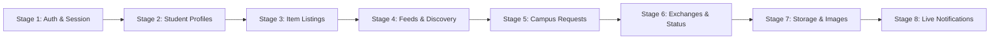

# BorrowBuddy – Staged Firebase Implementation Roadmap

**Document Version:** 1.0.0  
**Target:** Step-by-Step Production Integration Plan  
**Architecture:** Non-Breaking Incremental Migration  

---

## Roadmap Overview

---

## Stage 1: Firebase Authentication & Session Lifecycle

### 1.1 Objective
Establish robust user authentication using Firebase Authentication, link every user session to a unique Firebase UID, and guarantee complete session teardown upon sign-out.

### 1.2 Files Expected to Change
- `LoginActivity.kt`
- `RegisterActivity.kt`
- `SplashActivity.kt`
- `MainActivity.kt`
- `ProfileFragment.kt`
- `StudentProfileRepository.kt`

### 1.3 Existing Methods to Reuse
- `auth.signInWithEmailAndPassword(email, password)`
- `auth.createUserWithEmailAndPassword(email, password)`
- `auth.sendPasswordResetEmail(email)`
- `StudentProfileRepository.syncWithFirebase(user)`

### 1.4 New Methods Required
- `StudentProfileRepository.clearSession()`: Resets `currentUserProfile` and `currentUserItems` to empty states on logout.
- `ExchangeRepository.clearSession()`: Clears active in-memory exchange list and unseen tracking sets on logout.
- `NotificationRepository.clearSession(context)`: Clears cached notifications and SharedPreferences read IDs on logout.

### 1.5 Dependencies
- None (Foundation Stage).

### 1.6 Technical Risks & Mitigations
- **Risk:** Multi-account data bleeding on the same physical device.
- **Mitigation:** Explicitly call `clearSession()` on all repositories inside `ProfileFragment.btnLogout.setOnClickListener` before navigating to `WelcomeActivity`.

### 1.7 Testing Strategy
- Register a test account.
- Sign out.
- Sign in with a second distinct account.
- Confirm previous user's name, listings, and history do NOT display.

### 1.8 Completion Criteria
- User registration, login, password reset, and sign-out function cleanly with Firebase Auth.
- Switching accounts on the same device results in zero residual in-memory state.

---

## Stage 2: Student Profile Creation, Synchronization & Masking

### 2.1 Objective
Persist student profiles to Firestore across two separate documents: private credentials in `users/{uid}` and public details in `public_profiles/{uid}`. Guarantee zero private email leakage.

### 2.2 Files Expected to Change
- `StudentProfileRepository.kt`
- `EditProfileBottomSheetFragment.kt`
- `StudentProfileActivity.kt`
- `ProfileFragment.kt`

### 2.3 Existing Methods to Reuse
- `StudentProfileRepository.getCurrentUserProfile()`
- `StudentProfileRepository.getPublicStudentProfile(studentId, studentName)`
- `StudentProfileRepository.updateCurrentUserProfile(...)`
- `StudentProfileRepository.fetchPublicProfileFromFirestore(studentId, onResult)`

### 2.4 New Methods Required
- `StudentProfileRepository.attachProfileSnapshotListener(uid: String)`: Real-time listener for profile edits.
- `StudentProfileRepository.incrementCompletedCounters(uid: String, isLend: Boolean)`: Atomic Firestore increment for exchange completions.

### 2.5 Dependencies
- Stage 1 (Firebase Auth UID).

### 2.6 Technical Risks & Mitigations
- **Risk:** Public profile query returning private emails or security credentials.
- **Mitigation:** Strict field mapping in `fetchPublicProfileFromFirestore` and Firestore Security Rules enforcing `!('email' in request.resource.data)`.

### 2.7 Testing Strategy
- Unit test `StudentProfileRepositoryTest` verifying `getPublicStudentProfile` returns `email == ""`.
- Query `public_profiles/{uid}` via Firestore console; verify document contains no email field.

### 2.8 Completion Criteria
- New student profiles are written upon registration.
- Profile edits in `EditProfileBottomSheetFragment` immediately update Firestore and propagate to UI.

---

## Stage 3: Firestore Item Listings & Ownership

### 3.1 Objective
Migrate item listings from in-memory lists to Cloud Firestore collection `items/{itemId}`, associating each listing with the owner's authenticated UID.

### 3.2 Files Expected to Change
- `ListItemActivity.kt`
- `StudentProfileRepository.kt`
- `MyListingsActivity.kt`
- `ItemDetailBottomSheetFragment.kt`

### 3.3 Existing Methods to Reuse
- `StudentProfileRepository.getCurrentUserItems()`
- `StudentProfileRepository.addCurrentUserItem(item)`
- `StudentProfileRepository.getAvailableItemsForStudent(studentId, studentName)`

### 3.4 New Methods Required
- `StudentProfileRepository.deleteItem(itemId: String, onComplete: (Boolean) -> Unit)`
- `StudentProfileRepository.updateItemAvailability(itemId: String, status: String)`
- `StudentProfileRepository.attachUserItemsListener(uid: String)`: Synchronizes personal listings in real time.

### 3.5 Dependencies
- Stage 2 (Student Profiles).

### 3.6 Technical Risks & Mitigations
- **Risk:** Offline creation causing duplicate IDs or lost items.
- **Mitigation:** Use Firestore `collection("items").document()` to pre-allocate Firestore document IDs, assigning `item.id = doc.id` prior to writing.

### 3.7 Testing Strategy
- Publish an item from `ListItemActivity`.
- Verify item appears in Firestore Console under `/items/{itemId}` with `ownerUid == request.auth.uid`.
- Reopen `MyListingsActivity`; verify item loads cleanly.

### 3.8 Completion Criteria
- Items listed by the student persist across app restarts and device reboots.
- Only the item owner can delete or edit their listing.

---

## Stage 4: Home & Explore Live Feeds & Query Filtering

### 4.1 Objective
Replace hardcoded static seed lists (`sampleItems`, `defaultItems`) in `HomeFragment` and `ExploreFragment` with live Firestore queries filtered by status, category, and department.

### 4.2 Files Expected to Change
- `HomeFragment.kt`
- `ExploreFragment.kt`
- `ExploreFilterBottomSheetFragment.kt`

### 4.3 Existing Methods to Reuse
- `CampusItemAdapter`
- `TrendingItemAdapter`
- `CampusLocationHelper.sortItemsByProximity(...)`
- `CampusLocationHelper.formatZoneWithWalkTime(...)`

### 4.4 New Methods Required
- `HomeFragment.setupRealtimeItemListener()`: Subscribes to `items.whereEqualTo("status", "AVAILABLE").orderBy("createdAt", DESCENDING).limit(20)`.
- `ExploreFragment.buildFirestoreFilterQuery(...)`: Constructs dynamic compound queries based on category chips, department filters, and price ranges.

### 4.5 Dependencies
- Stage 3 (Firestore Item Listings).

### 4.6 Technical Risks & Mitigations
- **Risk:** Composite query errors when combining multiple filter conditions (`category` + `department` + `isFree`).
- **Mitigation:** Deploy predefined composite index specifications in `firestore.indexes.json`.

### 4.7 Testing Strategy
- Student A lists an item.
- Student B opens Home and Explore on a separate device.
- Confirm Student A's item immediately renders in Student B's marketplace grid.

### 4.8 Completion Criteria
- Hardcoded fallback seed lists are retired or reserved strictly for empty offline states.
- Category filtering and search bar query live items from Firestore.

---

## Stage 5: Campus Item Requests (Glance Broadcast & Fulfill)

### 5.1 Objective
Connect urgent campus requests (Glance banner) to Firestore collection `campus_requests/{requestId}` with automatic expiration handling.

### 5.2 Files Expected to Change
- `RequestItemActivity.kt`
- `HomeFragment.kt`
- `HelpRequestBottomSheetFragment.kt`

### 5.3 Existing Methods to Reuse
- `GlanceRequest` model
- `HomeFragment.setupGlanceCard()`
- `HomeFragment.addCampusRequest(request)`

### 5.4 New Methods Required
- `HomeFragment.attachGlanceRequestsListener()`: Real-time listener on `campus_requests.whereEqualTo("state", "ACTIVE")`.
- `HelpRequestBottomSheetFragment.fulfillRequest(requestId: String, helperUid: String)`: Updates Firestore state to `"FULFILLED"`.

### 5.5 Dependencies
- Stage 2 (Student Profiles).

### 5.6 Technical Risks & Mitigations
- **Risk:** Expired requests cluttering the Glance carousel banner.
- **Mitigation:** Query filters `whereGreaterThan("expiresAt", Timestamp.now())` and auto-cleanup expired requests.

### 5.7 Testing Strategy
- Post an urgent request from Student A.
- Student B sees request in the Glance banner on Home tab.
- Student B taps "I Can Help"; request state updates to `"FULFILLED"`.

### 5.8 Completion Criteria
- Urgent requests sync across devices in real time.
- Fulfilled and expired requests disappear from active rotation.

---

## Stage 6: Exchange Lifecycle Management & Real-Time Status Updates

### 6.1 Objective
Migrate `ExchangeRepository` from in-memory mock data to Cloud Firestore collection `exchanges/{exchangeId}`, supporting the complete 7-step borrowing/lending lifecycle between two students.

### 6.2 Files Expected to Change
- `ExchangeRepository.kt`
- `ExchangesFragment.kt`
- `ExchangeDetailBottomSheetFragment.kt`
- `BorrowConfirmBottomSheetFragment.kt`
- `ExchangePassBottomSheetFragment.kt`
- `ActivityHistoryActivity.kt`

### 6.3 Existing Methods to Reuse
- `ExchangeRepository.getAll()`
- `ExchangeRepository.getBorrowItems()`
- `ExchangeRepository.getLendItems()`
- `ExchangeRepository.isItemAvailable(itemId)`
- `ExchangeRepository.hasUnseenActivity(tab)`
- `ActivityHelper.getActivityDescription(exchange)`

### 6.4 New Methods Required
- `ExchangeRepository.attachRealtimeExchangeListeners(uid: String)`: Listens to incoming lends (`ownerUid == uid`) and outgoing borrows (`borrowerUid == uid`).
- `ExchangeRepository.syncRemoteExchange(doc: DocumentSnapshot)`: Maps Firestore document to `ExchangeItem` and notifies registered observers.
- `ExchangeRepository.updateExchangeStatus(exchangeId: String, newStatus: ExchangeStatus, nextStep: Int)`: Writes status transition to Firestore.

### 6.5 Dependencies
- Stage 3 (Items) & Stage 4 (Feeds).

### 6.6 Technical Risks & Mitigations
- **Risk:** Desynchronization if one user confirms handover while the counter-party is offline.
- **Mitigation:** Firestore offline persistence caches writes and syncs upon reconnection; state stepper reflects server document truth.

### 6.7 Testing Strategy
- Execute two-account walkthrough: Student B requests Student A's item.
- Verify Student A receives request under `Lend` → `Incoming`.
- Accept, verify 4-digit PIN, confirm handover, initiate return, confirm return.

### 6.8 Completion Criteria
- Complete 7-step exchange transitions persist in Firestore.
- Exchanges tab, Activity History, and Profile activity cards update automatically on both accounts.

---

## Stage 7: Firebase Cloud Storage for Images (Avatars & Listings)

### 7.1 Objective
Replace local `content://` URIs and device-internal image files with secure Google Cloud Storage HTTPS URLs.

### 7.2 Files Expected to Change
- `ListItemActivity.kt`
- `EditProfileBottomSheetFragment.kt`
- `AvatarHelper.kt`

### 7.3 Existing Methods to Reuse
- Android PhotoPicker launcher (`ActivityResultContracts.PickVisualMedia()`)
- `AvatarHelper.compressImageBitmap(...)`

### 7.4 New Methods Required
- `AvatarHelper.uploadProfilePhoto(context, uri, uid, onComplete)`: Uploads bitmap to `profile_photos/{uid}/avatar.jpg` and retrieves HTTPS download URL.
- `AvatarHelper.uploadItemPhotos(context, uriList, itemId, onComplete)`: Uploads compressed images to `item_photos/{itemId}/` and returns array of download URLs.

### 7.5 Dependencies
- Stage 2 (Profiles) & Stage 3 (Item Listings).

### 7.6 Technical Risks & Mitigations
- **Risk:** Large camera photos causing slow uploads or memory crashes.
- **Mitigation:** Downsample image to 1080px max dimension and compress JPEG quality to 80% before starting upload.

### 7.7 Testing Strategy
- Upload a listing photo from Student A's device.
- Verify photo downloads and displays on Student B's device via standard image loader.

### 7.8 Completion Criteria
- Photos are accessible across different devices.
- No local `content://` URIs are stored in Firestore.

---

## Stage 8: Real-Time Notifications & Unread Tracking

### 8.1 Objective
Connect `NotificationRepository` to Firestore collection `notifications/{id}`, delivering push/inbox alerts for borrow requests, acceptances, and returns.

### 8.2 Files Expected to Change
- `NotificationRepository.kt`
- `NotificationsActivity.kt`
- `HomeFragment.kt` (Notification bell badge)

### 8.3 Existing Methods to Reuse
- `NotificationItem` model
- `NotificationRepository.registerListener(...)`
- `NotificationRepository.markAllAsRead(...)`

### 8.4 New Methods Required
- `NotificationRepository.sendNotification(recipientUid, type, title, description, exchangeId)`
- `NotificationRepository.attachNotificationsListener(uid: String)`: Real-time listener on `notifications.whereEqualTo("recipientUid", uid)`.

### 8.5 Dependencies
- Stage 6 (Exchanges).

### 8.6 Technical Risks & Mitigations
- **Risk:** Duplicate notifications for the same exchange transition.
- **Mitigation:** Use deterministic document IDs (e.g., `notif_${exchangeId}_${newStatus}`).

### 8.7 Testing Strategy
- Trigger borrow request.
- Confirm notification document appears in Firestore and updates NotificationsActivity on lender's phone.

### 8.8 Completion Criteria
- Real-time notification badges update automatically on the Home toolbar bell.
- Mark All as Read updates `isRead = true` in Firestore.
