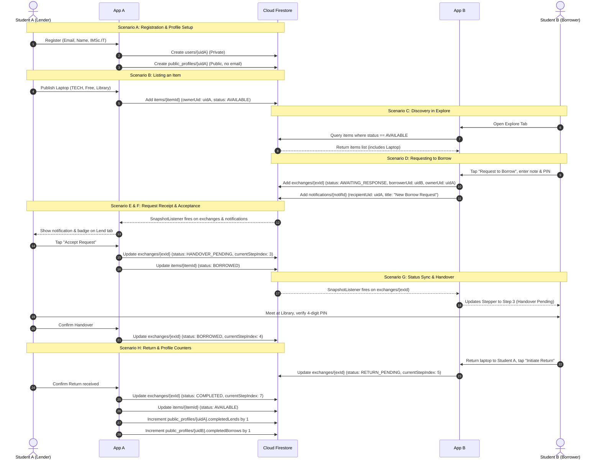

# BorrowBuddy – Cloud Firestore Database Schema Specification

**Document Version:** 1.0.0  
**Target Environment:** Google Cloud Firestore (Native Mode)  
**Security Reference:** `firestore.rules`  
**Application Package:** `com.borrowbuddy.app`  

---

## 1. Architectural Principles & Data Isolation

BorrowBuddy adopts a **student-first, privacy-by-design** schema architecture:
1. **Strict Separation of Private vs. Public Data:** Student private account data (authentication credentials, email addresses, creation timestamps) is isolated in `users/{userId}`, while student public identity (display name, department, semester, bio, avatar) is stored in `public_profiles/{userId}`. Private emails are NEVER exposed or queryable by other students.
2. **Normalized Master Entity Storage:** Core marketplace items and transactional exchanges live in dedicated root collections (`items` and `exchanges`) rather than deeply nested subcollections. This supports performant multi-attribute campus marketplace queries (e.g., department filtering, proximity sorting, price type) and allows both counterparties to an exchange to query and observe updates efficiently.
3. **Immutable Identifiers:** Document IDs for user documents correspond 1:1 with the Firebase Authentication UID (`request.auth.uid`). Transactional records use auto-generated Firestore document IDs (`doc.id`).
4. **Denormalization Safeguards:** Only immutable or rarely changing fields (e.g., owner first name, initial thumbnail URL) are denormalized into transactions to avoid distributed consistency lag during peer exchanges.

---

## 2. Collection Schemas

### 2.1 Collection: `users`
- **Path:** `/users/{userId}`
- **Document ID Strategy:** Matches the Firebase Authentication `user.uid` exactly.
- **Access Scope:** Private to the authenticated user (`request.auth.uid == userId`). No other student can read or write.

| Field Name | Data Type | Nullable | Description | Security / Validation Constraint |
| :--- | :--- | :---: | :--- | :--- |
| `uid` | `string` | No | Unique Firebase Authentication UID | Must equal `request.auth.uid` |
| `name` | `string` | No | Full legal / registered student name | 2–50 characters, trimmed |
| `email` | `string` | No | Registered campus / personal email | Valid email format; private |
| `createdAt` | `timestamp` | No | Server timestamp of account registration | Set via `FieldValue.serverTimestamp()` |
| `profileImage` | `string` | Yes | Local or remote reference to profile image | Optional URL string |
| `accountStatus` | `string` | No | Current account standing (`"active"`, `"suspended"`) | Controlled by system/admin |

---

### 2.2 Collection: `public_profiles`
- **Path:** `/public_profiles/{userId}`
- **Document ID Strategy:** Matches the Firebase Authentication `user.uid` exactly.
- **Access Scope:** Publicly readable by all authenticated campus students. Writable ONLY by the owner student (`request.auth.uid == userId`).

| Field Name | Data Type | Nullable | Description | Security / Validation Constraint |
| :--- | :--- | :---: | :--- | :--- |
| `uid` | `string` | No | Owner Firebase Authentication UID | Must equal `request.auth.uid` |
| `fullName` | `string` | No | Student display name shown on profile and cards | 2–50 characters |
| `college` | `string` | No | Campus affiliation (e.g. `"Gujarat University • Campus North"`) | Mandatory campus identifier |
| `department` | `string` | No | Academic department (e.g. `"IMSc.IT"`, `"IMBA"`) | Mandatory department string |
| `yearSemester` | `string` | No | Academic semester (e.g. `"4th Semester"`) | Academic progress indicator |
| `bio` | `string` | Yes | Student bio or study interests summary | Max 300 characters |
| `photoUri` | `string` | Yes | Public Cloud Storage HTTPS download URL | Must be HTTPS or empty string |
| `isVerifiedCampusStudent` | `boolean` | No | Official campus student badge status | **Client cannot set to true** (default: `false`) |
| `rating` | `string` | No | Formatted average peer rating (e.g. `"★ 5.0"`) | Defaults to `"★ 5.0"` |
| `completedLends` | `number` | No | Counter of completed lending exchanges | Incremented on exchange completion |
| `completedBorrows` | `number` | No | Counter of completed borrowing exchanges | Incremented on exchange completion |
| `updatedAt` | `timestamp` | Yes | Last profile update timestamp | Updated on profile edits |

---

### 2.3 Collection: `items`
- **Path:** `/items/{itemId}`
- **Document ID Strategy:** Auto-generated Firestore document ID.
- **Access Scope:** Publicly readable by all authenticated campus students. Created by authenticated students (`request.resource.data.ownerUid == request.auth.uid`). Updated and deleted ONLY by the listing owner (`resource.data.ownerUid == request.auth.uid`).

| Field Name | Data Type | Nullable | Description | Security / Validation Constraint |
| :--- | :--- | :---: | :--- | :--- |
| `id` | `string` | No | Document ID replica | Matches `doc.id` |
| `title` | `string` | No | Item title / name | 3–80 characters |
| `description` | `string` | No | Detailed description including specs, condition | Max 1000 characters |
| `category` | `string` | No | Item category (`"TECH"`, `"BOOKS"`, `"LAB"`, etc.) | Whitelisted category enum string |
| `priceLabel` | `string` | No | Display price (e.g. `"FREE"`, `"₹20/day"`) | String formatted with currency |
| `isFree` | `boolean` | No | True if zero monetary exchange | Boolean flag |
| `dailyPrice` | `number` | Yes | Numeric daily rate in INR (0 if free) | Non-negative integer |
| `pickupSpot` | `string` | No | Designated campus zone (e.g. `"Main Library"`) | Campus zone reference |
| `ownerName` | `string` | No | Display first name or full name of owner | Sourced from owner's public profile |
| `ownerUid` | `string` | No | Owner Firebase Authentication UID | Must equal `request.auth.uid` on create |
| `rating` | `string` | No | Owner rating badge at listing time | Sourced from owner profile |
| `imageUri` | `string` | Yes | Primary photo Cloud Storage HTTPS URL | Valid HTTPS URL or empty string |
| `additionalPhotos` | `list<string>` | Yes | URLs of supplementary item photos | Array of HTTPS URLs (max 5) |
| `department` | `string` | No | Owner department for peer filtering | Department string |
| `condition` | `string` | No | Item condition (`"Brand New"`, `"Good"`, etc.) | Condition tag |
| `maxDuration` | `string` | No | Max lending window (`"1 Day"`, `"Up to 3 days"`) | Duration string |
| `securityDeposit` | `string` | No | Security deposit label (e.g. `"None"`, `"₹200"`) | Deposit text |
| `status` | `string` | No | Listing status (`"AVAILABLE"`, `"BORROWED"`, `"HIDDEN"`) | Defaults to `"AVAILABLE"` |
| `createdAt` | `timestamp` | No | Creation timestamp | `FieldValue.serverTimestamp()` |
| `updatedAt` | `timestamp` | Yes | Last modification timestamp | `FieldValue.serverTimestamp()` |

---

### 2.4 Collection: `campus_requests` (Glance Feed)
- **Path:** `/campus_requests/{requestId}`
- **Document ID Strategy:** Auto-generated Firestore document ID.
- **Access Scope:** Publicly readable by all authenticated campus students. Created, updated, and deleted ONLY by the requesting student (`request.auth.uid == uid`).

| Field Name | Data Type | Nullable | Description | Security / Validation Constraint |
| :--- | :--- | :---: | :--- | :--- |
| `id` | `string` | No | Document ID replica | Matches `doc.id` |
| `uid` | `string` | No | Requester Firebase Authentication UID | Must equal `request.auth.uid` |
| `name` | `string` | No | Requester display first name | Max 30 characters |
| `item` | `string` | No | Name of item needed urgently | 2–60 characters |
| `location` | `string` | No | Specific campus spot where item is needed | Campus spot description |
| `avatarLetter` | `string` | No | Initial letter for avatar bubble | Single uppercase character |
| `description` | `string` | Yes | Context note (e.g., exam timing, urgency) | Max 300 characters |
| `category` | `string` | Yes | Optional category tag | Whitelisted category string |
| `quantity` | `string` | No | Quantity requested (e.g. `"1"`) | Defaults to `"1"` |
| `neededBy` | `string` | No | Urgency window (`"ASAP"`, `"Within 2 Hours"`) | Urgency string |
| `expirationHours`| `number` | No | Hours until automatic expiration | 6, 12, 24, or 48 |
| `state` | `string` | No | Request state (`"ACTIVE"`, `"FULFILLED"`, `"EXPIRED"`) | Defaults to `"ACTIVE"` |
| `helperUid` | `string` | Yes | UID of peer who offered help | Set upon fulfillment |
| `createdAt` | `timestamp` | No | Creation timestamp | `FieldValue.serverTimestamp()` |
| `expiresAt` | `timestamp` | No | Computed expiration timestamp | `createdAt + expirationHours` |

---

### 2.5 Collection: `exchanges`
- **Path:** `/exchanges/{exchangeId}`
- **Document ID Strategy:** Auto-generated Firestore document ID.
- **Access Scope:** Readable and writable ONLY by the two involved participants (`request.auth.uid == resource.data.ownerUid || request.auth.uid == resource.data.borrowerUid`). Unrelated users are denied all access.

| Field Name | Data Type | Nullable | Description | Security / Validation Constraint |
| :--- | :--- | :---: | :--- | :--- |
| `id` | `string` | No | Unique exchange transaction ID | Matches `doc.id` |
| `exchangeCode` | `string` | No | Human-readable tracking code (e.g. `"#EX-9201"`) | `#EX-` + 4-digit code |
| `itemId` | `string` | No | Foreign key reference to `items/{itemId}` | References valid item |
| `title` | `string` | No | Item title at request time | Denormalized snapshot |
| `category` | `string` | No | Item category | Denormalized snapshot |
| `imageUri` | `string` | Yes | Item photo download URL | Denormalized snapshot |
| `ownerUid` | `string` | No | Item lender Firebase UID | Participant 1 |
| `ownerName` | `string` | No | Item lender display name | Sourced from lender profile |
| `ownerDept` | `string` | No | Item lender department | Sourced from lender profile |
| `borrowerUid` | `string` | No | Item borrower Firebase UID | Participant 2 (Must != `ownerUid`) |
| `borrowerName`| `string` | No | Item borrower display name | Sourced from borrower profile |
| `borrowerDept`| `string` | No | Item borrower department | Sourced from borrower profile |
| `pickupSpot` | `string` | No | Agreed campus meeting point | Meeting location |
| `duration` | `string` | No | Agreed borrow duration | e.g. `"1 Day"`, `"2 Days"` |
| `priceLabel` | `string` | No | Price terms (e.g. `"FREE"`, `"₹20/day"`) | Financial terms snapshot |
| `isFree` | `boolean` | No | True if free lending | Boolean flag |
| `securityDeposit`| `string` | No | Agreed deposit terms | Deposit description |
| `requestDate` | `string` | No | Formatted request date string | Human-readable string |
| `handoverDate`| `string` | Yes | Formatted handover timestamp string | Set when handover occurs |
| `expectedReturnDate` | `string` | No | Expected return date/time | Agreed return deadline |
| `borrowerNote`| `string` | Yes | Optional note from borrower | Max 200 characters |
| `status` | `string` | No | Current exchange state enum string | Whitelisted state |
| `currentStepIndex` | `number` | No | Current UI stepper progress (1 to 7) | 1: Awaiting, 3: Handover, 4: Borrowed, 5: Return Pending, 7: Completed |
| `pin` | `string` | No | Secure 4-digit handover verification PIN | 4 numeric digits |
| `createdAt` | `timestamp` | No | Request timestamp | `FieldValue.serverTimestamp()` |
| `updatedAt` | `timestamp` | Yes | Last transition timestamp | `FieldValue.serverTimestamp()` |

#### Supported Exchange Status Enum Values:
1. `AWAITING_RESPONSE` (Step 1): Initial request created by Borrower, awaiting Lender response.
2. `ACCEPTED` / `HANDOVER_PENDING` (Step 3): Lender accepted; students arrange in-person handover.
3. `BORROWED` (Step 4): In-person handover completed via PIN confirmation; Borrower has possession.
4. `RETURN_PENDING` (Step 5): Borrower initiated return; students arrange in-person return.
5. `COMPLETED` (Step 7): Lender verified item return; exchange concluded.
6. `DECLINED`: Lender declined the request.
7. `CANCELLED`: Borrower cancelled prior to handover.
8. `OVERDUE`: Item has not been returned by `expectedReturnDate`.

---

### 2.6 Collection: `notifications`
- **Path:** `/notifications/{notificationId}`
- **Document ID Strategy:** Auto-generated Firestore document ID.
- **Access Scope:** Readable and writable ONLY by the recipient student (`request.auth.uid == resource.data.recipientUid`).

| Field Name | Data Type | Nullable | Description | Security / Validation Constraint |
| :--- | :--- | :---: | :--- | :--- |
| `id` | `string` | No | Notification document ID | Matches `doc.id` |
| `recipientUid` | `string` | No | Firebase Auth UID of intended recipient | Must equal `request.auth.uid` to read |
| `senderUid` | `string` | Yes | UID of peer triggering event | Informational |
| `type` | `string` | No | Notification category type | Whitelisted notification type enum |
| `title` | `string` | No | Bold notification headline | e.g. `"New Borrow Request"` |
| `description` | `string` | No | Short activity summary description | e.g. `"Priya requested to borrow..."` |
| `category` | `string` | No | Item category tag | e.g. `"TECH"`, `"BOOKS"` |
| `exchangeId` | `string` | Yes | Associated exchange reference | Foreign key to `exchanges` |
| `itemId` | `string` | Yes | Associated item reference | Foreign key to `items` |
| `isRead` | `boolean` | No | Read status flag | Defaults to `false` |
| `timestamp` | `timestamp` | No | Event timestamp | `FieldValue.serverTimestamp()` |

---

## 3. Required Firestore Composite Indexes

To execute compound filtered queries without index-missing errors, configure the following composite indexes in `firestore.indexes.json` or Firebase Console:

1. **Items Marketplace Compound Query:**
   - Collection: `items`
   - Fields: `status` (Ascending), `category` (Ascending), `createdAt` (Descending)
   - Scope: Collection
2. **Items Department & Price Query:**
   - Collection: `items`
   - Fields: `status` (Ascending), `department` (Ascending), `isFree` (Ascending)
   - Scope: Collection
3. **User Listings Query:**
   - Collection: `items`
   - Fields: `ownerUid` (Ascending), `createdAt` (Descending)
   - Scope: Collection
4. **Exchanges Counter-Party Query (Borrower):**
   - Collection: `exchanges`
   - Fields: `borrowerUid` (Ascending), `status` (Ascending), `updatedAt` (Descending)
   - Scope: Collection
5. **Exchanges Counter-Party Query (Lender):**
   - Collection: `exchanges`
   - Fields: `ownerUid` (Ascending), `status` (Ascending), `updatedAt` (Descending)
   - Scope: Collection
6. **Notifications Chronological Feed:**
   - Collection: `notifications`
   - Fields: `recipientUid` (Ascending), `timestamp` (Descending)
   - Scope: Collection

---

## 4. End-to-End Data Lifecycle Walkthrough (Scenarios A through H)

---

## 5. Schema Normalization & Performance Considerations

1. **Avoiding Subcollections for Exchanges:** Subcollections under `users/{uid}/exchanges` would require complex collection group queries and duplicate writes whenever an exchange state changes. A root collection `exchanges` with `ownerUid` and `borrowerUid` fields allows a single atomic document write to update both students simultaneously.
2. **Denormalization Budget:** Only snapshot strings (`title`, `category`, `imageUri`, `ownerName`, `borrowerName`) are copied into `exchanges`. Mutable attributes like user rating, current bio, and profile avatar are resolved on-demand via `StudentProfileRepository.getPublicStudentProfile()`.
3. **No Financial / Payment Data:** BorrowBuddy handles peer-to-peer campus physical exchanges; no credit cards, bank accounts, or sensitive payment tokens are ever stored in Firestore.
